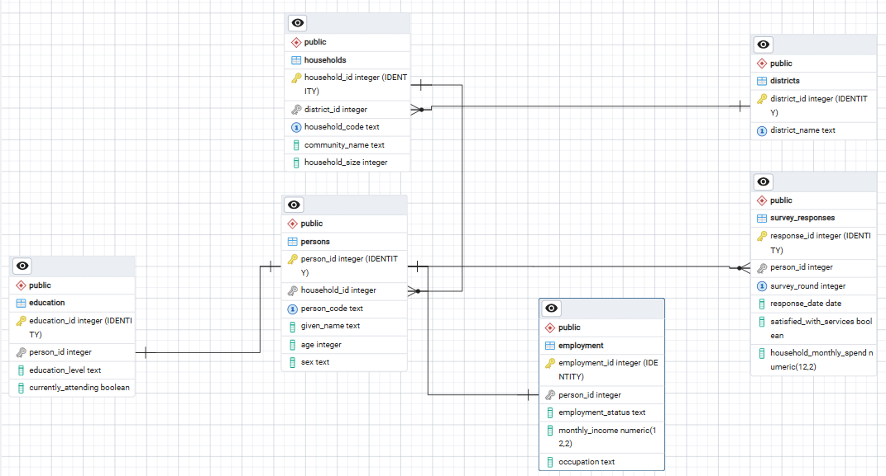

# Survey Database

## 1. Project Overview

Survey Database is a relational database developed using PostgreSQL to organize household and individual-level survey information.

The database provides a structured way to store geographical information, household records, individual demographic details, education information, employment information and survey responses. It applies relational database principles to maintain data consistency, enforce relationships and support structured data retrieval.

The project demonstrates the application of relational database design, normalization principles, primary and foreign keys, integrity constraints, indexing, SQL views, database security and administration practices.

## 2. Project Objectives

The database is designed to:

- Organize district and household information in a structured relational format.
- Maintain individual records associated with their respective households.
- Store education and employment information for individuals.
- Record survey responses across different survey rounds.
- Enforce data integrity through primary keys, foreign keys and validation constraints.
- Support data retrieval through database indexes and a summary view.
- Provide a structured foundation for secure database access and administration.
- Support database backup, recovery and maintenance procedures.

## 3. Technology Stack

| Technology | Purpose |
|---|---|
| PostgreSQL 18.6 | Relational database management system |
| SQL | Database definition, manipulation and querying |
| pgAdmin 4 | Database administration and management |
| PostgreSQL command-line tools | Database creation, backup, restoration and administration |
| Entity Relationship Diagram (ERD) | Documentation of database structure and relationships |

## 4. Database Structure

The database contains six relational tables and one database view.

### 4.1 Database Tables

| Table | Description |
|---|---|
| `districts` | Stores district identification and names. |
| `households` | Stores household records and their geographical associations. |
| `persons` | Stores individual demographic information linked to households. |
| `education` | Stores education information associated with individuals. |
| `employment` | Stores employment status, occupation and income information. |
| `survey_responses` | Stores individual survey responses across survey rounds. |

### 4.2 Database View

The `person_survey_summary` view provides a consolidated query result containing selected individual, district, education, employment and survey response information.

The view returns the following eight columns:

| Column | Description |
|---|---|
| `person_code` | Unique code identifying the individual. |
| `given_name` | Individual's given name. |
| `age` | Individual's recorded age. |
| `district_name` | Name of the district associated with the individual's household. |
| `education_level` | Recorded education category for the individual. |
| `employment_status` | Recorded employment status of the individual. |
| `survey_round` | Survey round associated with the response. |
| `satisfied_with_services` | Indicates whether the individual reported satisfaction with services. |

The `households` table provides the relationship path between individuals and districts. However, household-specific fields such as `household_code`, `community_name` and `household_size` are not included in the view output.

The view also does not return `response_date` or `household_monthly_spend`.

Since an individual can have multiple survey responses across different survey rounds, the view may return multiple rows for the same individual.

## 5. Entity Relationships

The database implements five foreign-key relationships:

1. One district can be associated with multiple households.
2. One household can contain multiple persons.
3. A person can have zero or one associated education record.
4. A person can have zero or one associated employment record.
5. A person can have multiple survey responses, subject to the survey-round uniqueness constraint.

The education and employment relationships use unique foreign keys. This ensures that each person can have no more than one corresponding record in each of those tables, while allowing a person to have no record in either table.

The `survey_responses` table allows multiple records for an individual but enforces uniqueness for each combination of `person_id` and `survey_round`.

## 6. Database Integrity and Constraints

The database uses the following integrity mechanisms:

- **Primary keys:** Uniquely identify records in each table.
- **Foreign keys:** Maintain relationships between related tables.
- **Unique constraints:** Prevent duplicate district names, household codes and person codes.
- **Check constraints:** Validate selected values and numerical ranges.
- **Not-null constraints:** Ensure required fields contain values.
- **Default values:** Provide predefined values for selected fields.
- **Composite unique constraint:** Prevent duplicate responses for the same individual within the same survey round using `person_id` and `survey_round`.

These constraints help maintain data accuracy and consistency throughout the database.

## 7. Indexing and Query Performance

The database includes three additional indexes:

- `idx_households_district_id` on `households(district_id)`.
- `idx_persons_household_id` on `persons(household_id)`.
- `idx_responses_date` on `survey_responses(response_date)`.

These indexes support queries involving district associations, household membership and survey response dates.

In addition to these explicitly defined indexes, PostgreSQL creates indexes to support primary key and unique constraints.

Query performance can be assessed using PostgreSQL query analysis tools such as `EXPLAIN` and `EXPLAIN ANALYZE`. Index selection and query optimization should be guided by actual query patterns and execution plans.

## 8. Database Security and Access Control

Database security is important for protecting survey information against unauthorized access, modification, disclosure and loss.

The database should be administered using appropriate authentication, authorization and access-control practices.

### 8.1 PostgreSQL Authentication

PostgreSQL uses database roles and authentication rules to control access to database servers and databases.

Authentication should be configured to ensure that only authorized users and applications can connect to the database.

Recommended practices include:

- Use strong and unique passwords for database accounts.
- Avoid sharing administrator credentials.
- Use secure authentication methods supported by the PostgreSQL installation.
- Restrict database connections to trusted users, applications and network locations.
- Keep database credentials outside publicly accessible source code.
- Review authentication configuration and connection permissions regularly.

### 8.2 Database Roles and Responsibilities

PostgreSQL roles can be used to assign database privileges according to the responsibilities of different users.

The following role categories provide a recommended access-control structure:

| Role Category | Responsibilities | Recommended Access |
|---|---|---|
| Database Administrator | Manages database configuration, users, permissions, backups and maintenance. | Administrative privileges appropriate to the assigned responsibilities. |
| Database Owner | Controls the database objects and their ownership. | Ownership privileges over assigned database objects. |
| Data Entry / Application User | Performs authorized data insertion and updates through an application or approved database interface. | Limited `INSERT`, `UPDATE` and, where required, `SELECT` privileges. |
| Data Analyst / Reporting User | Retrieves information for reporting and analysis. | Read-only access to approved tables or views. |
| Backup Operator | Performs authorized database backup and restoration operations. | Only the privileges and operating-system access required for backup and recovery tasks. |

These are recommended role categories, not a statement that the corresponding PostgreSQL roles have already been created in this project.

### 8.3 Principle of Least Privilege

Users should receive only the database permissions required to perform their assigned responsibilities.

For example:

- Reporting users should not receive unnecessary permission to modify survey records.
- Application accounts should not use PostgreSQL superuser privileges.
- Administrative privileges should be restricted to authorized database administrators.
- Database ownership should be assigned deliberately rather than shared among ordinary users.

This approach reduces the risk of accidental data modification and unauthorized database operations.

### 8.4 Database Permissions

PostgreSQL provides privilege controls for databases, schemas, tables, sequences and other database objects.

Access permissions should be configured according to the assigned role.

Administrative access, data modification permissions and read-only reporting access should be separated wherever possible.

Privileges should also be reviewed when users change responsibilities or no longer require database access.

### 8.5 Data Protection

Survey information may contain personal and household-level details. Appropriate measures should therefore be applied when storing, accessing, exporting and sharing data.

Recommended measures include:

- Restrict access to identifiable survey information.
- Avoid publishing real household or respondent records in public repositories.
- Use synthetic or appropriately anonymized records for demonstrations.
- Protect database backups and exported files.
- Avoid storing passwords or other sensitive credentials in GitHub.
- Apply appropriate retention and disposal procedures to exported survey data.

## 9. Database Backup and Recovery

Database backups are essential for recovering information after accidental deletion, database corruption, hardware failure or other operational incidents.

PostgreSQL provides tools for creating and restoring database backups.

### 9.1 Schema-Only Backup

A schema-only backup contains database definitions without the actual records.

The project's `database/schema.sql` file is a schema-only SQL export. It contains the definitions of the database tables, constraints, indexes and view.

It does not contain household, individual or survey response records.

### 9.2 Full Database Backup

A full logical database backup can be created using:

```powershell
pg_dump -U postgres -d survey_database -F c -f survey_database_backup.dump
```

This creates a custom-format backup containing the database schema and data.

Replace `postgres` with the appropriate PostgreSQL user if necessary.

### 9.3 Database Restoration

A custom-format backup can be restored using:

```powershell
pg_restore -U postgres -d survey_database survey_database_backup.dump
```

The target database must exist before restoration unless the appropriate database-creation option is used.

Restoration should be tested in a suitable environment before relying on a backup for production recovery.

### 9.4 Global Roles and Permissions

A backup of an individual database does not include all PostgreSQL cluster-wide role definitions.

Where role definitions must also be backed up, PostgreSQL provides:

```powershell
pg_dumpall -U postgres --globals-only -f postgres_globals.sql
```

This exports global objects such as roles and tablespaces.

Backup files containing sensitive information should be stored securely and should not be committed to a public GitHub repository.

## 10. Database Administration and Maintenance

Database administration involves managing database access, monitoring performance, maintaining data integrity and ensuring the continued availability of database services.

Important administration activities include:

### 10.1 User and Role Management

- Create and manage authorized PostgreSQL roles.
- Assign appropriate privileges.
- Review database ownership and access permissions.
- Revoke access when it is no longer required.

### 10.2 Data Management

- Perform authorized data insertion, updating and deletion.
- Maintain referential integrity.
- Validate data before importing records.
- Monitor database consistency.

### 10.3 Performance Monitoring

- Review query execution plans.
- Identify inefficient queries.
- Assess index usage.
- Monitor database activity and resource consumption.

### 10.4 Routine Maintenance

- Perform regular database backups.
- Monitor database storage.
- Review database logs.
- Run appropriate maintenance operations, including `VACUUM` and `ANALYZE`, when necessary.
- Test backup restoration procedures.

Maintenance activities should be performed according to the database environment and operational requirements.

## 11. Entity Relationship Diagram

The following diagram illustrates the database tables, their attributes and the relationships implemented through foreign keys.



## 12. Repository Structure

```text
survey_database/
│
├── database/
│   └── schema.sql
│
├── documentation/
│   ├── database_design.md
│   ├── data_dictionary.md
│   └── database_operations_security.md
│
├── diagrams/
│   └── er_diagram.png
│
├── scripts/
│
├── sample_data/
│
├── screenshots/
│
└── README.md
```

## 13. Database Installation and Setup

### Requirements

- PostgreSQL 18.6 or a compatible PostgreSQL version.
- pgAdmin 4 or PostgreSQL command-line tools.
- Access to the project repository.

### Step 1: Create the Database

Using pgAdmin 4, create a database named:

```sql
CREATE DATABASE survey_database;
```

Alternatively, use the pgAdmin database creation interface.

### Step 2: Execute the Database Schema

Connect to the newly created `survey_database` database and execute the SQL statements contained in:

```text
database/schema.sql
```

The schema file defines the database tables, relationships, constraints, indexes and view.

Alternatively, from the project root, use the PostgreSQL command-line tool:

```powershell
psql -U postgres -d survey_database -f database/schema.sql
```

Replace `postgres` with the appropriate PostgreSQL database user if necessary.

### Step 3: Verify Database Objects

After executing the schema, confirm that the following objects have been created:

- Six database tables.
- Five foreign-key relationships.
- Three additional indexes.
- One database view named `person_survey_summary`.

The schema file contains database definitions rather than survey records. Data must be inserted separately where required.

### Step 4: Configure Database Access

Database users and permissions should be configured separately from the schema installation.

Create appropriate PostgreSQL roles, assign database and schema privileges, and restrict access according to the responsibilities of each user.

Do not use a PostgreSQL superuser account for routine application or reporting operations.

## 14. Project Scope and Limitations

This repository contains a standalone relational database for household and individual survey information.

Its scope is limited to:

- Relational database structure and design.
- Household and individual information organization.
- Education and employment record management.
- Survey response storage across survey rounds.
- Referential integrity and validation constraints.
- Database indexing and structured information retrieval.
- Database security and administration considerations.
- Backup, recovery and maintenance procedures.

The repository does not represent a complete survey fieldwork management application or a national survey administration platform.

It does not include a web-based data collection interface, field enumerator management, survey scheduling, automated reporting dashboards or application-level user authentication.

These capabilities would require additional application development and integration.

## 15. Technical Documentation

| Document | Description |
|---|---|
| `database_design.md` | Explains database architecture, relationships and design decisions. |
| `data_dictionary.md` | Provides table and column definitions, data types and constraints. |
| `database_operations_security.md` | Covers database administration, access control, security, backup, recovery and maintenance considerations. |

## 16. Conclusion

The Survey Database provides a structured PostgreSQL implementation for organizing household and individual survey information.

Its relational design, integrity constraints, indexes and summary view establish a foundation for consistent data storage, relationship management and structured information retrieval.

The project also addresses important database administration considerations, including access control, PostgreSQL role management, data protection, backup, recovery and maintenance.

Together, these elements demonstrate the application of relational database design and PostgreSQL administration principles in a survey data management context.